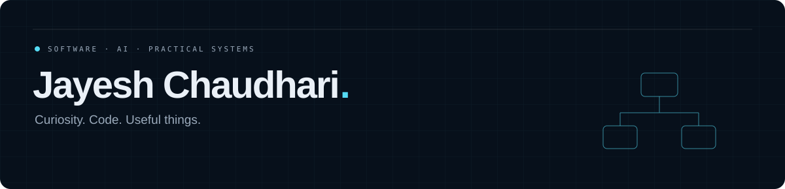

  <a href="https://jayeshchaudhari1210.github.io/portfolio/">Portfolio</a> ·
  <a href="https://drive.google.com/file/d/1ThGIr0xpbBz1rMcmM7Bd3WdZi626aH3j/view?usp=drivesdk">Résumé</a> ·
  <a href="https://github.com/jayeshchaudhari1210?tab=stars">Learning library</a> ·
  <a href="https://www.linkedin.com/in/jayeshchaudhari1210/">LinkedIn</a> ·
  <a href="mailto:jayeshchaudhari1210@gmail.com">Email</a>

## Hello, I’m Jayesh.

I’m a software developer exploring **AI tools, web applications, and practical systems**. I’m interested in how interfaces, workflows, and the tools underneath them fit together—and what makes them useful.

This is my main workspace for personal and professional software, learning, independent projects, and open-source interests. [JayeshCC](https://github.com/JayeshCC) is reserved for existing Oppidan collaboration and preserved historical work.

### Selected work

| Project | What it explores | Current stage |
| :--- | :--- | :--- |
| [**Aiwork**](https://github.com/jayeshchaudhari1210/Aiwork) | Python task/agent workflows, dependencies, retries, and guardrails | Alpha local core; several external integrations are prototypes/placeholders |
| [**Smart File Manager**](https://github.com/jayeshchaudhari1210/Smart-File-Manager) | Desktop file navigation, tagging, and copy operations | Early application; platform support and file-operation reliability need improvement |
| [**SATHI / Manodarsh**](https://github.com/DurgeshBhusnale/manodarsh_v2) | Collaborative questionnaire/dashboard software; contribution and attribution notes below | Team prototype; no clinical-effectiveness or official employment claims |
| [**Sentimeter**](https://github.com/jayeshchaudhari1210/sentimeter) | API concepts, examples, and product documentation | Documentation work; advertised sentiment application is not implemented in this repository |

See [my contribution notes and public commit evidence](CONTRIBUTIONS.md), including the development-account attribution context for SATHI. Project histories retain their original authors, teammates and automation; see each repository for implementation details and limitations.

### Technical toolkit

**Languages:** Python · JavaScript · TypeScript · C · C++ · Java · SQL  
**Applications:** React · Flask · API development · Agent workflows  
**Environment:** Linux · Git · Docker · Development tooling

### The reference shelf

My [**starred library**](https://github.com/jayeshchaudhari1210?tab=stars) brings learning paths and useful tools together: programming practice, AI/ML, security, Linux, automation, self-hosting, and career resources. These are saved references—not claims of authorship or blanket endorsements.

### A little context

- B.E. Information Technology, NMIET — 2024–2027
- Diploma in Computer Engineering, Pimpri Chinchwad Polytechnic — 2021–2024
- Exploring practical applications and continuing to learn by building.

### Let’s connect

Explore the [portfolio](https://jayeshchaudhari1210.github.io/portfolio/), browse my [repositories](https://github.com/jayeshchaudhari1210?tab=repositories), or [send an email](mailto:jayeshchaudhari1210@gmail.com).

Layout inspired by GitSkins’ Recruiter-ready template. Activity and contribution history are available on this profile; no combined or invented account statistics are shown.
